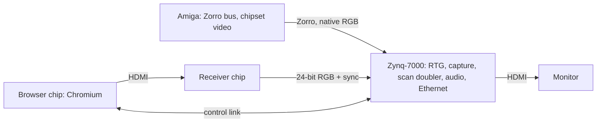

# Architecture

Scope: the blocks of the design under study, its data and control paths, the browser plane, and a summary of the safety rules.
Status: draft

## Blocks

| Block | Role | Status |
|---|---|---|
| Zynq-7000 | Owns the Zorro bus, native capture, the scan doubler, final scanout and HDMI out, as on a ZZ9000 | [G] design |
| Receiver | ADV7611 class; SoC HDMI to 24-bit RGB 4:4:4 | [G]; Linux exposes RGB888_1X24 for the ADV7611 (`linux@6c377d19d4a5:adv7604.c:L709-711`) [F] |
| Browser chip | Chromium with GPU raster and compositing | [G]; candidates in `sections/browser-chip.md` |
| Control link | Input, commands, clipboard, window geometry, files and a heartbeat between the 68k client, the Zynq and the SoC; audio too, proposed (K7) | [G]; transport open (K8) |
| 68k client | The Workbench window, menus, ASL, clipboard, keymap, ARexx; tracks the window rectangle and occluders | [G] design |
| Host daemon | On the SoC: CEF windowed host, input injection, dialog and download handlers, audio sink | [G] proposed (DEC-014 mechanism, K50) |
| Audio | Browser audio joins the card's existing audio fabric | One line here; depth deferred |
| Power | The Zorro side stays on the slot; the SoC takes a PSU lead or its own supply [D] DEC-003 | One line here; depth deferred |

- [F] A CM5 alone may draw up to 5 A at 5 V (`cm5-ds` p6), against 2.0 A at +5 V per Zorro III slot [R `zorro3`]; so the slot cannot feed the SoC [G], and the SoC's own feed must not back-feed the receiver or the Zynq side (K35).

## Paths

- **Pixels:** SoC compositor → HDMI → receiver → async line FIFO → plane in the formatter → HDMI out [G].
- **Input:** the 68k client writes input and commands into the card; the Zynq forwards them over the control link [G].
- **Monitor clock:** always the Zynq's own; the SoC never drives the output timing [D] DEC-013.
- **Latency targets [G]:** from input arriving at the Zynq to the vblank that latches the changed frame, ≤ 2 frames + 1 ms for a compositor scroll and ≤ 3 frames + 1 ms for a DOM change (p95, 60 Hz).

## The plane

- [G] The browser is composited by the SoC at the Intuition window's screen position, in a mode equal to the RTG screen's; the FPGA keys it into the window rectangle through the line FIFO.
- [G] Occlusion (Amiga windows, menus, Chromium popups over the plane) uses a rectangle list from Intuition ClipRects, a few registers per rectangle.
- [F] The precedent is the firmware's native P96 PIP: a second MM2S VDMA shares HP0 and feeds ping-pong line buffers in `video_formatter`, with colour-key composition (`fw@8778ef3:docs/native-p96-pip.md:L39-51`).
- [F] That plane is packed YUV422 by design (`fw@8778ef3:docs/native-p96-pip.md:L55-57`).
- [G] YUV422 halves horizontal chroma resolution, so it is not lossless for text; the browser plane needs an RGB mode.
- [F] Colour-key occlusion in the PIP "remains opportunistic" (`fw@8778ef3:docs/native-p96-pip.md:L139-140`).
- [F] Primary scanout has AXI priority 15 over the overlay's 0 on the shared HP0 port (`fw@8778ef3:docs/native-p96-pip.md:L164`).
- [G] The plane is RTG-only; over a scan-doubled native screen it would need composition after the doubler, deferred until RTG works.

## AXI ports in use today

[F] `fw@8778ef3:zz9000_project.tcl:L1233-1238, L1304-1319`:

| Port | Master |
|---|---|
| HP0 | Both video VDMAs (RTG scanout and the PIP overlay) |
| HP1 | Zorro `m01` (capture writeback) |
| HP2 | Audio MM2S |
| HP3 | Audio S2MM |
| ACP | Zorro `m00`, through a width converter |
| S_AXI_GP0 | Disabled (`PCW_USE_S_AXI_GP0 {0}`); GP1 is never enabled |

## Control link (K8)

- [F] PS USB0 is the Amiga-side USB host on MIO 28-39, and the console is UART1 on MIO 48-49 (`fw@8778ef3:zz9000_project.tcl:L1225, L1181`).
- [R `ug585`] USB1 would need MIO 40-51, colliding with that console.
- [F] The firmware terminates Ethernet on the A9 and bridges raw frames to the Amiga; it has no TCP/IP stack (`fw@8778ef3:os/ethernet.c`; no lwIP in `os/`).
- [F] GEM0 (ENET0, MIO 16-27) is the only Ethernet controller the PS7 configuration enables, and it is the port the firmware bridges to the Amiga (`fw@bdfd8b0:zz9000_project.tcl:L855, L884-885`; `os/ethernet.c:L291`).
- [F] The firmware runs it at 10/100 on either PHY type: `link_speed = 100` under a FIXME, 10 and 100 advertised, the 1000BASE-T advertisement cleared, then autonegotiation restarted (`fw@bdfd8b0:os/ethernet.c:L1085-1121, L1142-1148`).
- Candidates [G]: UART0 on MIO plus a USB-serial bridge for a split SBC, or Ethernet through an on-card switch on GEM0.
- [G] A control link through a GEM0 switch shares the Amiga's LAN segment unless the ports are isolated or VLANs are used.

## Safety summary

[D] DEC-005: nothing the SoC does, or fails to do, can touch native capture, the doubler or scanout.
The rules are SR1-SR16 in `topics/plane-safety.md`; for V-tracked the binding set is SR2, SR4 (fail-closed line FIFO), SR6, SR7, SR9, SR10, SR13, SR14, SR15 and SR16.
