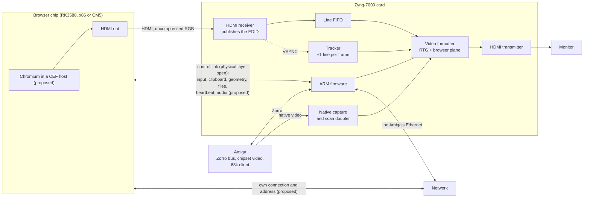

# RFC 0001: Native modern web browsing on Zorro Amigas

| | |
|---|---|
| Author | Thomas Dye |
| Status | Draft, in review; nothing is built yet. |
| Last updated | 2026-10-12 |
| Decision owner | Thomas Dye. Firmware changes also need the BlitterStudio maintainers' agreement, and Replica changes its maintainer's. |
| Feedback | First, whether a new card is the right route (Q15); then packaging (Q1–Q3 in §11). The review stays open until they're settled. Comment on this file's pull request. |
| Sources | This repository's `.kb/`; estimates are marked. Amiga terms: Appendix A. |
| Licence | Not chosen yet (§9); the project is not planned as closed-source. |

## 1. Summary

I want a big-box Amiga to browse the modern web natively: nearly any site, YouTube and Discord included, in a Workbench window or full screen, up to 1920×1080 at 60 Hz (1080p60).
To the user it's a Workbench program (§4).

The browser engine, Chromium (proposed, Q16), runs on a separate computer, the browser chip: an RK3588, x86 or Raspberry Pi CM5 module or board (candidates in §7).
The browser chip, which I assume runs Linux, sends its picture over HDMI to a receiver on a new Zorro card built around a Zynq-7000, the FPGA-plus-ARM chip of the MNT ZZ9000.
The browser chip has its own network connection, and a control link carries input, clipboard and files between it and the Amiga (§4).
The Zynq runs neither Linux nor Chromium: it keeps the ZZ9000's bare-metal firmware, with additions.

Who it's for, and what it costs:

- It's for A2000, A3000 and A4000-class Amigas with a Zorro slot; page pixels never cross the Zorro bus or the 68k, so by design the Amiga's CPU doesn't limit the page.
- It costs a new card and a browser chip with its own power feed; no price is set (Appendix B).
- It does nothing for an emulated Amiga, an existing ZZ9000 or another RTG card; a route that serves existing cards isn't ruled out (§6, Q15).

The Zynq draws the browser chip's picture, uncompressed, into the browser window, and keeps doing everything a ZZ9000 with its audio add-on does: RTG, native video capture and scan doubling, audio and Ethernet.
It keeps its own pixel clock and follows the browser chip by making each frame up to one line longer or shorter, so a browser-chip crash never blanks the monitor.
The biggest risk is whether monitors accept those one-line changes.

Where things stand:

| Choice | State |
|---|---|
| Whether to build new hardware | Open (Q15) |
| Requirements (§3) | Decided, except the 1080p60 and latency targets (Q12) |
| Workbench look and feel | Decided; mechanisms (§4) Proposed |
| Chromium as the engine, and its host program (§4) | Proposed (Q16) |
| The Zynq always owns the monitor's clock, and tracks frames only on RTG screens | The first is Decided; the second follows from the native-video requirement (§3) |
| HDMI receiver with ±1-line frame tracking | Proposed; open on monitor acceptance (§10) |
| Acquisition buffer, and native-screen browsing from it | Proposed; open on DDR headroom (§10), and native screens after RTG works |
| Browser chip, on its own network connection | Open (§7, §10); the connection is Proposed |
| Packaging | Open (Q1) |
| Zynq-7000, as a chip-down 7020 in CLG484 | Proposed (Q3) |

## 2. Motivation and background

Amiga users can't use the modern web from Workbench.
Native browsers such as NetSurf can't keep up with current sites, and proxies such as Browservice put a network round trip in every interaction.
None of the 68k, a 68k accelerator or the ZZ9000's own ARM cores is fast enough for a current browser engine (estimate), and those ARM cores run bare-metal firmware with no operating system to host one.
So a current engine needs a second, Linux-class computer; designs differ in how its picture reaches the Amiga's screen.

The [MNT ZZ9000](https://mntre.com/zz9000/) is a Zorro graphics and coprocessor card built on a Zynq-7020 module; BlitterStudio maintains its [bare-metal firmware and FPGA logic](https://github.com/BlitterStudio/zz9000-firmware) and [AmigaOS drivers](https://github.com/BlitterStudio/zz9000-drivers).
The ZZ9000 Replica is a feature-enhanced recreation for the A2000, A3000 and A4000, not yet public.
Neither a stock ZZ9000 nor today's Replica has the FPGA pins for an HDMI receiver, so the result is a new card, a Zynq card plus a single-board computer (SBC), or a redesigned Replica (Q1).

The closest prior art is the firmware's experimental `centered_1080p_match` profile, which moves each frame's end to follow native video; mine moves it one line per frame at most.

## 3. Requirements and non-goals

| Requirement | Measure |
|---|---|
| Modern web | Nearly any website works; YouTube and Discord's website are the examples. |
| 1080p output | Native pass-through and RTG both reach 1920×1080 on 16:9 monitors. |
| Full-screen browser (a target, Q12) | A browser filling a 1080p60 Workbench screen meets the §7 target; neither that size nor 60 fps is required. |
| Video with sound in step | Web video should play with its sound synchronized; no tolerance is set, and 40 ms is proposed ([`.kb/topics/audio-path.md`](../.kb/topics/audio-path.md)). |
| Workbench look and feel | The window, gadgets and dialogs are the Amiga's; files go to and from Amiga volumes. |
| The Amiga keeps its own TCP/IP address | The browser doesn't take over the Amiga's network stack or address (§4). |
| Input latency (Proposed, Q12) | At the 95th percentile, from input reaching the Zynq to the vertical blank that shows it: 2 frames + 1 ms (scroll), 3 frames + 1 ms (DOM update); the 1 ms is the control link and line FIFO. |
| No blank or resync caused by the browser | Opening, closing, moving or resizing the window, or a browser-chip reboot or hang, never blanks or resyncs the monitor. Events that already resync it still may: a requested mode change, an Amiga reboot, a native↔RTG switch. |
| Native video never disrupted | Capture, scan doubling and pass-through work in every mode, browser or not; feeding the browser into the capture input would displace native capture. |

I'm not doing 3D acceleration or Amiga-side H.264 decode.
Uncompressed pixels are a property of this design, not a requirement.
The browser chip's software holds its display mode across Chromium restarts, never blanks the screen or toggles hot-plug, and changes mode only when the Zynq asks.

## 4. Architecture

The browser chip sends a normal HDMI signal to a receiver on the Zynq card, which turns it back into parallel RGB.
The FPGA passes that through a four-line FIFO into its video formatter, which draws it as a plane in the browser window.
A control link carries input, clipboard, window geometry, files, a heartbeat and, I propose, audio (Q8, Q9).
The dotted line is the receiver's vertical sync (VSYNC).

**Timing and colour.** The receiver publishes a DVI-only EDID listing only the Zynq's RTG timings, so the browser chip sends full-range RGB and no HDMI audio.

**Tracking.** A tracker in the FPGA makes each frame at most one line longer or shorter, inside vertical blanking.
Once the two frame starts are within the FIFO's reach, the tracker is locked and the plane shows.
The tracker runs only on RTG screens, so native output never takes its timing from the browser chip.
That needn't rule out native screens: after RTG works, and if DDR headroom allows (§10), I propose showing the browser there from the acquisition buffer (§5), at most a frame behind ([`.kb/topics/native-screens.md`](../.kb/topics/native-screens.md)).

**Failure.** If the browser chip loses HDMI or its heartbeat times out (Q10), the plane turns off, the output carries on, and the window shows a placeholder.

**Look and feel.** A 68k client owns the window, and the Amiga draws its frame, gadgets, toolbar, menus and requesters; only the page comes from the browser chip.
I propose running Chromium in a Chromium Embedded Framework (CEF) host (Q16), which hands its dialogs to the client: ASL requesters for files, Amiga requesters for page alerts, confirmations and prompts.
Downloads save to an Amiga volume and uploads read from one, over the control link; confining downloads to one drawer is open (Q14).
I propose that text copies both ways through the Amiga clipboard; typing follows your keymap, and the Amiga drives the pointer.
I propose printing to a PDF on an Amiga volume.
Amiga windows on top cut holes in the plane (Q7).

**Network.** The browser chip has its own network connection and address; it doesn't use the Amiga's TCP/IP stack, and the Amiga keeps the card's Ethernet and its own address.
With one card I propose one network socket shared through a switch chip; with an SBC, its own Ethernet or Wi-Fi.
I'd put the browser on a guest network, which with a shared socket needs a VLAN-capable router.
The control link never carries the browser's network traffic, and isn't reachable from the network; over the card's Ethernet port that needs a VLAN or a second MAC (Q9).

**Sound.** I propose that browser sound joins the Amiga's on the card (Q8) and plays from its line output.
Today's firmware sets up no sound on the HDMI output, so I expect none to reach the monitor (not verified).

## 5. Lock time and when the browser window waits

In normal use the tracker locks long before a window opens, so opening, closing or moving it costs nothing.
After a native↔RTG switch, an Amiga reboot, a cable replug or a browser-chip reboot, closing the gap at one line per frame takes up to 9.4 s at 1080p60, too long after an Amiga reboot.
So I propose an acquisition buffer: while the tracker converges, the plane shows the newest frame from a three-frame ring in the Zynq's DDR, which cuts that wait to about a frame.
It needs no extra parts, but must survive an Amiga reset, and I propose that it gives way to PIP, so with PIP open the 9.4 s wait returns (Q6).
Its cost in DDR, and every event with its wait: [`.kb/sections/display-coupling.md`](../.kb/sections/display-coupling.md), "Mitigations" and "When the window is not live".

## 6. Options considered

| Option | Status | Reason |
|---|---|---|
| HDMI receiver, ±1-line tracking (this design) | Proposed | Open on monitor acceptance (§10). |
| Zynq fetches frames over PCIe (needs a 7015) | Second choice, if HDMI misses latency targets | Frames need about 520 MB/s, 600 with overhead (estimate): two Gen2 lanes or more, ruling out the CM5 and RK3588S. |
| Frame-buffered fallback: the Zynq buffers every frame | Fallback if monitors reject the changes | No tracker and no monitor risk, for a frame more latency, a repeated or dropped frame now and then, and a DDR3 chip only the CLG484 7020 has pins for, or the existing DDR at PIP's cost. |
| Browser chip locks to the Zynq's VSYNC | Preferred if available | None known to support it (not verified). |
| Direct HDMI (TMDS) into the FPGA | Rejected: 1080p output | The FPGA's I/O tops out near 1.25 Gb/s per lane; 1080p60 needs 1.49 Gb/s. |
| Browser chip supplies the monitor clock | Rejected: no blank | A browser-chip reboot blanks the monitor. |
| A newer or non-AMD FPGA | Not under study | A full firmware port. |
| A browser on a networked computer, shown through an existing ZZ9000 or other RTG card | Not ruled out; outside this RFC | It serves cards people already own, and is preferable if it reaches the goal (Q15); it costs a network round trip in every interaction (§2). |

Where the browser can't show, the window has a placeholder and the monitor never blanks ([`.kb/sections/overview.md`](../.kb/sections/overview.md), [`.kb/sections/display-coupling.md`](../.kb/sections/display-coupling.md)):

- At 2560×1440.
- On native screens until the buffered path (§4) is built.
- In custom RTG modes the fixed EDID doesn't list.
- When the browser chip sends 59.94 Hz.

## 7. Browser chip candidates

A chip meets the target if, at full-screen 1080p60, its 95th-percentile frame time is at most 16.7 ms, it misses at most 1% of frames in a 60 s heavy-page scroll, and it meets the §3 latency targets.
The target isn't a hard requirement, so missing it doesn't alone rule a chip out (Q12); among chips that meet it, integration decides, then price, then power.

| Chip | Strengths | Weaknesses |
|---|---|---|
| RK3588 | Exact timings plausible from its fractional-PLL HDMI PHY (unverified); four PCIe lanes. | Chromium on its open-source Mali driver is young. |
| x86 (Intel N-series, AMD Ryzen Embedded) | The most mature Chromium GPU path; full-range RGB control. | Power and heat in an Amiga case; exact timings unverified. |
| Raspberry Pi CM5 | Ecosystem; one 5 V input; two HDMI outputs. | Doubtful at full-screen 1080p60; exact timings unverified. |

With one card I'd pick the cheapest chip that meets the target; with an SBC, users pick and I publish which meet it.

## 8. Hardware

The AmigaOS drivers stay as they are; the new work is the FPGA receive path, its firmware, the 68k client and the board.
The firmware also keeps the tracker engaged when output timing is unchanged, so a colour-depth change costs nothing, and moves its 720p preset close to standard timing; both need the maintainers' agreement (Q11).
The board starts from the Replica's Zorro buffers, level translators, capture front end, HDMI transmitter and audio.

The receiver needs 28 FPGA pins: today's Replica module has one free and a 7015 module adds only 12, while a chip-down 7020 in CLG484 fits them (estimate) with room for the fallback's DDR3, but has no PCIe ([`.kb/topics/zynq-pin-budget.md`](../.kb/topics/zynq-pin-budget.md)).

A CM5's power input is rated 5 A against Zorro III's 2.0 A per slot at +5 V, so the browser chip takes power from a spare PSU drive lead or its own supply, isolated so it can't back-feed the receiver.

## 9. Cross-cutting concerns

| Concern | Position | Open |
|---|---|---|
| Security | I assume the browser chip can be compromised. It has no bus access and can't place the plane, so the main exposure is the control-link parsers. I propose keeping Chromium's sandbox on, never running as root, and a guest network (§4). | Patching, clipboard and downloads (Q14) |
| Browser-chip image | No distribution is chosen. Build scripts, and optionally a prebuilt image; not decided. Versions pinned to what was measured, and re-measured before upgrades. | How updates reach users (Q14) |
| Licensing | The firmware and drivers are GPL-3.0-or-later and stay so; Chromium and CEF are BSD-style. | This repository's licence, chosen before code lands; Amiga fonts in Chromium; the ADV7611 register manual. |
| Power and thermal | Separate browser-side power (§8); one card designed for no airflow; an SBC can sit outside the case. Settled by testing and analysis; not a blocker. | Spare drive leads; design ambient temperature |

## 10. What hardware would show

Analysis comes first, and any test comes last.
Only hardware can show the first two of these four points; for the last two, simulation and arithmetic come first.
What would show each, and what counts as a pass: [`.kb/unknowns.md`](../.kb/unknowns.md), "Test methods".

| Open point | What the answer changes |
|---|---|
| Whether monitors accept the ±1-line changes (Q4) | A no means the frame-buffered fallback. |
| Whether a browser chip meets the §7 target and the §3 latency at the Zynq's exact timings | The chip; missing the latency points to PCIe (§6). |
| Whether the tracker locks at small clock offsets and rejects large ones with RTG undisturbed | The FPGA design. |
| Whether the Zynq's DDR has headroom for the buffer beside scanout, capture, audio and Ethernet | Whether the buffer and native-screen browsing are built. |

Any new board must also match today's ZZ9000 frame for frame (CRC) on native video in every mode, outside the browser window when it's showing.
The first point decides the most, and a ZZ9000 and a monitor are enough to show it; reports of how a monitor takes the firmware's `centered_1080p_match` profile (v2.8.0 and later) are welcome as a GitHub issue naming the monitor.

## 11. Open questions

Most have my current proposal; if you can't live with one, say so.

| # | Decision | Options | Proposed | What it changes |
|---|---|---|---|---|
| Q15 | Whether to build new hardware at all | This card; a route that an existing ZZ9000 or other RTG card can use (§6) | The cheapest route that reaches the goal (§1); not settled | Whether this card is built. |
| Q1 | Packaging | One card with a browser-chip module; a Zynq card plus an SBC; a redesigned Replica | No lean; slot-fit and SoC-on-Zorro experience welcome. | Who carries the chip's power, heat and layout, and whether users pick the chip; the Replica is someone else's design. |
| Q2 | What JLCPCB can't source or place | Per part | Standard assembly for all but plug-in modules | Such a part is consigned, swapped or moved to a module. |
| Q3 | Zynq part and form | Chip-down 7020 (CLG484) or 7015 (CLG485); MYIR 7015 module | Chip-down 7020: pin margin and the fallback's DDR3, no PCIe. LCSC chips are fine for production (Appendix B). | A module removes Zynq layout and sourcing but leaves no pins to spare. |
| Q4 | Monitors tolerate ±1-line changes? | Yes; no | Yes; only hardware can show it (§10) | No means the frame-buffered fallback. |
| Q5–Q7 | FPGA-internal choices: raster alignment on entering RTG from native; PIP and the buffer sharing DDR reads; occlusion | In [`.kb/sections/display-coupling.md`](../.kb/sections/display-coupling.md) and [`.kb/sections/architecture.md`](../.kb/sections/architecture.md); for occlusion: a rectangle list, a 1-bit mask in DDR or a colour key | Independent rasters; PIP wins; a rectangle list | Reboot waits without the buffer; the 9.4 s wait with PIP open; a mask adds DDR reads, and a colour key misfires on matching content. |
| Q8 | Browser audio | Control link; HDMI audio from the receiver | Control link | HDMI audio needs 4 more FPGA pins and an HDMI EDID, which risks limited-range RGB. |
| Q9 | Control link physical layer | UART and USB-serial bridge; Ethernet on an isolated switch port, plus a VLAN or second MAC | After Q1 and Q8 | Audio (48 kHz 16-bit stereo needs about 1.92 Mbaud on a UART), file transfer speed and the SBC's connectors; files rank below input, control and audio. |
| Q10 | Hang recovery | Heartbeat timeout, then reset by the Zynq or a supervisor chip | Open, including the timeout | An unmodified SBC needs a wired reset. |
| Q11 | How the browser feature ships in the ZZ9000 firmware | A bitstream variant for cards with the hardware; a firmware SDK service; mainline, enabled on that hardware | Open; the firmware maintainers have the biggest say | The firmware's build and release work. |
| Q12 | The §3 latency targets and the §7 frame-rate target | Tighter; as stated; looser | As stated, as targets, not hard requirements | Tighter could favour PCIe; looser widens the chip choice and favours the frame-buffered fallback (§6). |
| Q13 | Look-and-feel gaps | Drop-down lists in pages, which Chromium draws as windows that can pass the window edge; the right mouse button, also the Amiga's menu button; printer output | Open | How native these feel. |
| Q14 | Browser-chip security policy | Update channel for patched images; clipboard rules each way; download confirmation, and whether downloads are confined to one drawer | Open | Who keeps the chip patched; Chromium ships security fixes weekly. |
| Q16 | Browser engine and its host | Chromium in a CEF host; a stock packaged browser | CEF so far; open, because less engine upkeep is better | CEF hands dialogs to the Amiga as events, but the project ships every engine update itself, its published builds have no H.264 or AAC unless the project builds its own, and Google may refuse sign-in from embedded browsers. A stock browser gets fixes and those codecs from its distribution (Debian's and Raspberry Pi's packages carry them), but its dialogs reach the Amiga only through Chromium's remote-control protocol, which its owner doesn't support for third-party use, and its context menus and permission prompts stay pixels. |

If you've done HDMI receive into an FPGA, RK3588 or CM5 display work, CEF on ARM Linux, SoC thermals or chip-down Zynq at JLCPCB, please comment or point someone here.

## Appendix A. Glossary

| Term | Meaning |
|---|---|
| ASL requester | The standard Amiga file requester |
| Chip-down | Soldered to the board, not on a plug-in module |
| EDID | Data a display sends listing the timings it supports |
| PIP overlay | The firmware's picture-in-picture plane for video players |
| Requester | An Amiga dialog box |
| RTG | Retargetable graphics: Amiga screens drawn by a graphics card, not the chipset |
| Scan doubler | Converts the Amiga's 15 kHz video to a rate modern monitors accept |
| Workbench | The AmigaOS desktop |
| Zorro | The big-box Amiga expansion bus |

## Appendix B. Comparison prices

There's no target price yet; these are the most expensive parts only, for comparing options.
USD list prices at quantity 1, as shown on 2026-10-10.
"Authorized" means findchips flags the distributor as authorized for the part.

| Part | Price (USD) | Stock |
|---|---|---|
| Zynq 7020 bare chip, XC7Z020-1CLG484C | 156.60 authorized (Avnet); 97.25 at LCSC | Authorized: none. LCSC: 57 |
| Zynq 7015 bare chip, XC7Z015-1CLG485C / -2CLG485I (industrial) | 162.00 / 214.65 authorized (Avnet); 63.32 / 75.40 at LCSC | Authorized: none. LCSC: 12 / 261 |
| MYIR MYC-C7Z020-V2 module (7020, CLG400) | 147, or 150 industrial (first 2 pieces) | Direct from MYIR |
| MYIR MYC-C7Z015 module (7015, industrial) | 124 (first 2 pieces) | Direct from MYIR |
| Raspberry Pi CM5 Lite module, 2× HDMI; 4 / 8 / 16 GB | 100 / 165 / 335 | PiShop.us; 16 GB out of stock |
| Radxa CM5 module (RK3588S2), 1× HDMI; RAM/eMMC 4/32, 8/64, 16/128, 32/256 GB | 89 / 119 / 179 / 299 | Out of stock (Arace, Allnet) |
| LattePanda Mu N100 x86 module; 8 / 16 GB | 359 / 499 | DFRobot; 16 GB out of stock |

At authorized list price a bare 7020 costs more than a whole MYIR module, which also carries DDR3 and flash.
